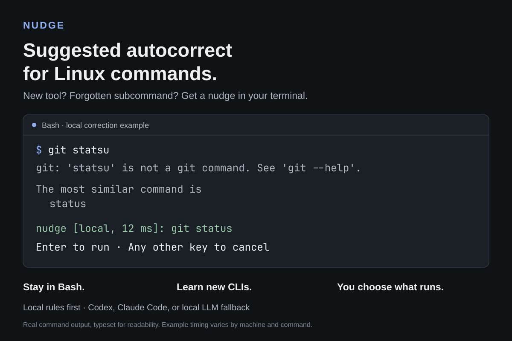

# Nudge

**Suggested autocorrect for Linux commands.** Spend less time remembering syntax
and more time using your tools—especially a new CLI you are still learning.

After an eligible command fails, Nudge suggests a correction in your existing
Bash terminal. **Press Enter to run it, or any other key to cancel.** It can fix
mistyped subcommands and supported missing command paths; it does not silently
rerun commands.



**Local rules run first; cloud fallback is enabled by default.** If local rules
cannot choose an eligible correction, Nudge automatically asks **Codex (OpenAI)**
using your existing CLI login. **Claude Code (Anthropic)** and **local LLMs** are
selectable alternatives. Set `NUDGE_LOCAL_ONLY=1` to disable all model requests.
Enter confirms running the proposed command; the model request happens before
that prompt, without separate confirmation.

```text
$ git statsu
…unknown subcommand…

git status
[Enter to run · any other key to cancel]
```

Nudge is written in Rust for **Linux and Bash 5+**. It does not require a specific
Linux distribution or desktop environment. It is under active development;
command coverage is still expanding. Download the portable x86_64 Linux bundle
from [GitHub Releases](https://github.com/gammamike/nudge/releases/latest), or
build from source. The license is GPL-3.0-only.

## How it works

- A Bash prompt hook checks failed commands without replacing the shell.
- Local rules correct unambiguous syntax errors using reviewed adapters and
  installed command metadata.
- Model fallback supports **Codex** (the default), **Claude Code**, and **local LLMs**
  through Ollama or a local server implementing the OpenAI-compatible API.
- The proposed command is displayed before execution. Arguments are passed
  literally; model output is never evaluated as shell code.

The executable name must be correct: `git statsu` can become `git status`, but
`gti status` is ignored. Valid commands that fail because of permissions,
connectivity, or missing resources are not automatically retried.

## Install and enable

The Linux x86_64 bundle requires Bash 5+ and no Rust toolchain. Download the binary
archive, matching source archive, and `SHA256SUMS` from the
[v0.1.2 release](https://github.com/gammamike/nudge/releases/tag/v0.1.2).

With the defaults below, unresolved eligible commands can trigger a cloud request
through your existing Codex login. For local rules only, add
`export NUDGE_LOCAL_ONLY=1` to `~/.bashrc` **before** starting the new shell. Run
the same export in your current shell to disable model requests there too.

In the download directory:

```bash
sha256sum -c SHA256SUMS
tar -xzf nudge-0.1.2-linux-x86_64.tar.gz
cd nudge-0.1.2-linux-x86_64
./install.sh
exec bash
```

Alternatively, build from source with Git, Rust 1.88+, and Cargo:

```bash
git clone https://github.com/gammamike/nudge.git
cd nudge
./install.sh
exec bash
```

The installer copies Nudge into per-user directories, backs up `~/.bashrc`, and
adds one managed setup block. The installed copy does not depend on the checkout.
If you already source `nudge.bash` manually, remove that source block first.
Use `--no-modify-shell` to manage your own shell setup.

A static x86_64 binary bundle requires no Rust toolchain at runtime. See
[installation instructions](docs/INSTALLATION.md) for bundle verification,
custom paths, and XDG locations. Local LLM support also requires `curl` and a
separately running inference server.

To update from your checkout, run `git pull --ff-only`, `./install.sh`, then
`exec bash`. For binary updates, run the installer from a new verified bundle.

```bash
nudge rollback   # Restore the previous installed payload, if available.
nudge uninstall  # Remove Nudge and its managed shell setup.
```

These are separate lifecycle actions. Start a fresh Bash shell afterward.
Uninstall preserves settings, cache, backups, and unrelated shell configuration.
Set `NUDGE_ENABLED=0` to disable the hook in the current shell.

For development without installation, build with `cargo build --locked --release`
and run `./try-bash`. The source-build executable is `target/release/nudge-rust`.

## System and package installation

For staged installs and distro packages, use the `nudge-bash` command. The
Makefile supports `PREFIX` and `DESTDIR` and installs a man page, Bash completion,
and license notices. Activation is explicit; package installation does not edit
user startup files. See [system installation](docs/SYSTEM_INSTALL.md).

AUR recipes for `nudge-bash` and `nudge-bash-bin` are prepared; AUR listings are
not yet published. Use the GitHub release or source installer in the meantime.
See the [release and AUR guide](docs/RELEASING.md) for validation and submission.

### Optional desktop companion

The [Omarchy companion](docs/OMARCHY_COMPANION.md) adds a welcome/setup panel and
settings for **Codex, Claude Code, and local LLMs**. Command corrections happen in
your terminal; the panel helps you install and configure them. Its controls follow
your active Omarchy theme.

```bash
omarchy plugin add https://github.com/gammamike/nudge.git --enable
```

The welcome panel opens once after first enable. Select **Install Nudge & enable
Bash**, then open a new Bash terminal. On Linux x86_64, the button downloads and
verifies this version's release, installs the CLI for your user, backs up and
updates `~/.bashrc`, and adds **Nudge Settings** to **Super+Space**. No Rust
toolchain or administrator password is needed. Installation is explicit; opening
the panel does not install software or contact a model.

To reopen it without a launcher:

```bash
omarchy-shell shell summon gammamike.nudge '{}'
```

It requires Omarchy Shell plugin support, `jq`, GNU core utilities, `curl`,
`tar`, `gzip`, and `flock`. Existing package/custom installations and other
architectures use the [installation guide](docs/INSTALLATION.md). Existing
managed user installations reuse their installed CLI during setup.

Remove the launcher from Setup before running
`omarchy plugin remove gammamike.nudge`. Removing the companion preserves the
CLI, Bash hook, and provider settings; run `nudge uninstall` separately to remove
the managed CLI installation. Nudge also works without a companion or desktop.

## Local corrections and model providers

To use deterministic local corrections without any model calls:

```bash
export NUDGE_LOCAL_ONLY=1
```

Unset that variable, or set it to `0`, to allow the selected provider. Models are
optional; missing authentication or an unavailable provider produces no model
suggestion. Nudge does not switch providers automatically.
Add the export to `~/.bashrc` to keep it enabled in future Bash shells. This mode
also disables local LLM requests; deterministic local corrections still work.

Choose one provider; the following are alternatives, not a setup sequence:

| Provider | Saved configuration example |
|---|---|
| Codex subscription CLI | `nudge config --provider codex --model YOUR_MODEL_ID` |
| Claude Code subscription CLI | `nudge config --provider claude --model YOUR_MODEL_ID` |
| Local LLM with Ollama | `nudge config --provider ollama --model YOUR_INSTALLED_MODEL_ID` |
| Local LLM with a compatible HTTP server | `nudge config --provider local --model YOUR_MODEL_ID --endpoint http://127.0.0.1:1234/v1` |

Replace model placeholders with an available model ID or supported alias. Run
`nudge config` to inspect effective settings. Local models
can be listed with `models --provider ollama` or `models --provider local`.

Codex is the default provider; Claude Code and local LLMs are selectable
alternatives. Codex and Claude Code use their CLI's existing subscription login
and reject API-key authentication. Provider limits and account-level billing
settings still apply. Local inference requires a model loaded on your server.

See [provider configuration](docs/PROVIDERS.md) for authentication, local server
endpoints, model overrides, privacy boundaries, and environment settings.

## What leaves your machine

When cloud fallback runs, Codex sends the selection request to OpenAI, or Claude
Code sends it to Anthropic. Nudge supplies command/subcommand syntax and candidate
routes (including their descriptions), not terminal scrollback, unrelated shell
history, or command output. Argument-aware adapters omit paths, IDs, option
values, and other preserved operands. Catalog-based matchers send the accepted
literal command words with shortlisted routes, so those words are not redacted.

Local LLM providers use a loopback server. Ensure that server performs inference
locally rather than forwarding requests elsewhere. `NUDGE_LOCAL_ONLY=1` disables
all model requests. See [data sent and failure handling](docs/PROVIDERS.md#data-sent-and-failure-handling)
for details and [local inference](docs/PROVIDERS.md#local-inference) for server
restrictions.

## Command coverage

The registry currently contains **271 executable adapters**, with deliberately
scoped support. It includes Git, Docker/Compose, systemd, common file/text tools,
desktop utilities, Cargo, Pacman/Yay query operations, Nix, iwctl, Zellij, and strace.
A listed executable does not imply support for every option or subcommand.

- [Git, Docker/Compose, and systemd support](docs/FIRST_CLI_BATCH.md)
- [Additional Linux profiles, exact scopes, and timings](docs/LINUX_PROFILES.md)
- [Nix, iwctl, Zellij, and strace scopes and tests](docs/NESTED_CLI_BATCH.md)
- [Latest 147 adapters, Buildx scopes, and tests](docs/CLI_EXPANSION.md)
- [Codex, Claude Code, Ollama, and Gemini command scopes](docs/AI_CLI_BATCH.md)
- [Supported and pending requested commands](docs/CLI_STATUS.md)
- [Launch coverage checklist](docs/CLI_SUPPORT.md)
- [Additional requested tools](docs/CLI_ADDITIONS.md)

List registered executable names:

```bash
nudge supported
```

Inspect a suggestion without executing it:

```bash
nudge suggest --local-only --command 'git statsu'
```

Pipelines, shell expansions, compound commands, executable-name typos, and Bash
aliases/functions are outside the current scope. Commands omitted from shell
history are skipped. Destructive and privilege-changing forms are excluded or
restricted by the individual adapter.

## Request another tool

[Open a CLI support request](https://github.com/gammamike/nudge/issues/new?template=cli-support.yml)
with the executable, Linux distribution, version, and examples of expected
corrections. Include cases that should be left alone. Replace private paths,
credentials, hostnames, and resource identifiers with placeholders.

Check [existing requests](https://github.com/gammamike/nudge/issues) first. The
[request guide](docs/CLI_REQUEST_TEMPLATE.md) explains the information needed to
review a new adapter.

## Development

```bash
cargo build --locked --release
cargo fmt --check
cargo clippy --locked --all-targets -- -D warnings
cargo test --locked
python3 -m unittest discover -s tests -v
for script in nudge.bash interactive.bash try-bash install.sh scripts/*.sh companion/omarchy/*.sh tests/distribution-smoke.sh; do bash -n "$script"; done
```

Integration tests require Python 3.11+, `curl`, and `jq`. They exercise the Rust binary
using captured metadata, mock executables, and loopback servers. No model login
or live model requests are needed.

See [contribution guidelines](CONTRIBUTING.md), [development notes](docs/DEVELOPMENT.md),
[packaging instructions](docs/PACKAGING.md), [distribution options](docs/DISTRIBUTION_OPTIONS.md), the [distribution test report](docs/DISTRIBUTION_TESTS.md),
and the [changelog](CHANGELOG.md). For setup problems, see
[troubleshooting](docs/TROUBLESHOOTING.md).

## License

[GNU General Public License v3.0 only](LICENSE) (`GPL-3.0-only`).
